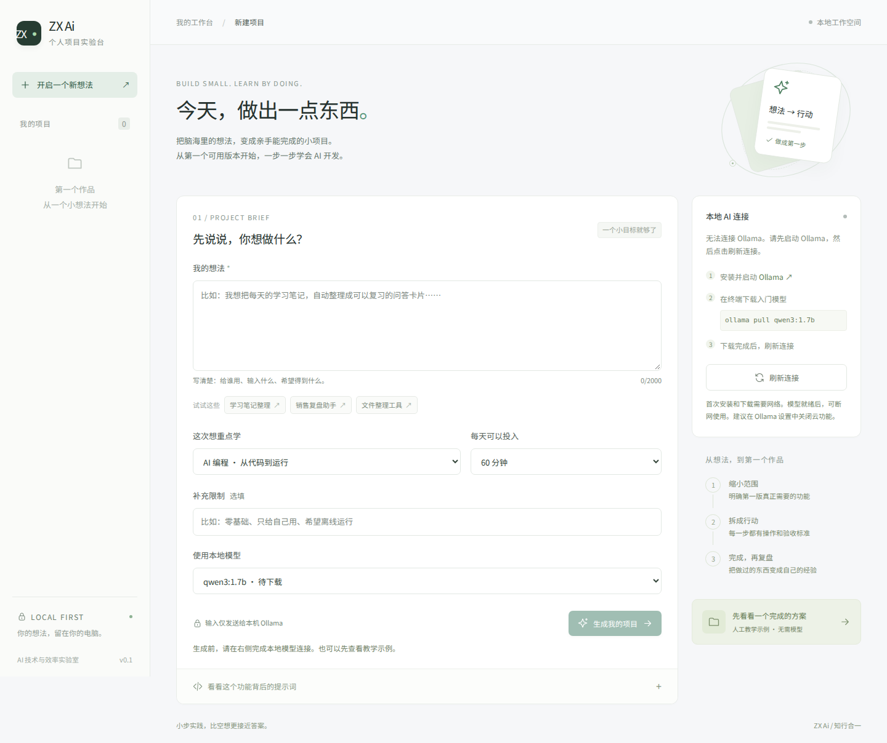

# ZX Ai · 个人项目实验台

**把一个想法，变成一个能亲手完成的小项目。**

这是 `my-first-ai` 的第一个可运行原型：输入想法、限制和每天可用时间，本地 AI 生成 MVP 范围、任务、验收标准和学习点；你勾选进度、记录复盘，再导出 Markdown。

适合一个人边做边学 AI 编程、产品设计和自动化。它自动完成「需求 → 提示词 → 模型 → 结构校验 → 保存」这条流程；计划中的开发任务仍由你执行。



[查看项目详情界面](docs/screenshots/project.png) · [查看本轮验证记录](docs/VERIFICATION.md)

## 为什么先做这个场景

一个想法经常停在“应该做什么”，难以落到第一步。这个工具用一个真实的小闭环练习表单、接口、提示词、结构化输出、数据库和测试；每次新的学习或产品想法都能复用。相比直接堆出通用聊天、知识库和智能体，当前版本的完成标准更容易亲自验证。

延续 ZX Ai 的本地优先方向：**Ollama + Qwen3、本地 SQLite、显式区分模型结果和教学示例。** 当前交付是电脑浏览器中的本地应用。React + TypeScript + Vite 保留为前端基础；第一版用 Node.js 24 内置 HTTP/SQLite 减少运行依赖，Tauri 2 / Rust 桌面封装列入后续路线。

## 已实现与验证边界

| 功能                                         | 状态                                          |
| -------------------------------------------- | --------------------------------------------- |
| 输入想法、限制、学习重点、时间预算           | 已实现，前后端校验                            |
| 检测本地模型、选择 Qwen3 1.7b / 4b / 8b      | 已实现，仅允许本机 Ollama                     |
| 真实 `/api/chat` 接入，JSON Schema 约束输出  | 已实现；HTTP 协议测试通过，真实模型待设备验证 |
| 生成 3–8 个任务，包含操作、验收标准、学习点  | 已实现，无效输出不保存                        |
| SQLite 历史、搜索、勾选、复盘、删除          | 已实现；重开数据库持久化测试通过              |
| Markdown 导出                                | 已实现，保留完成状态和结果来源                |
| 提示词预览、生成时提示词快照与版本           | 已实现，方便对照学习                          |
| 超时、取消、缺失模型、重复请求和并发修改处理 | 已实现并测试                                  |
| 人工教学示例                                 | 已实现，明确标注“非 AI 生成”，不调用模型      |
| 真机断网推理、速度、输出质量                 | **尚未验证**：开发环境没有 Ollama 和模型权重  |
| 桌面安装包、云模型、自动执行文件或命令       | 未实现，见[迭代清单](docs/ROADMAP.md)         |

## 第一次运行

需要 **Node.js 24.x**（使用内置 TypeScript 与 SQLite）和 Git。检查版本：

```bash
node --version
```

应显示 `v24.x.x`。可从 [Node.js 官方网站](https://nodejs.org/) 安装 24.x。

### 1. 下载并启动应用

```bash
git clone https://github.com/andychen1314424-cloud/my-first-ai.git
cd my-first-ai
```

如果本功能 PR 还没合并，先切换到实现分支；合并到 main 后可以省略这一句：

```bash
git switch feat/zx-ai-project-lab
```

然后运行：

```bash
npm ci
npm run build
npm start
```

打开 **http://127.0.0.1:4173**。保留终端运行，按 `Ctrl+C` 停止。

此时即使没有模型，也能点击「先看看一个完成的方案」，体验任务勾选、保存复盘和导出。**这只是人工教学示例，不会冒充 AI 生成。**

### 2. 接通真正的本地 AI

从 [Ollama 官方网站](https://ollama.com/download) 安装并启动 Ollama。另开一个终端，下载入门模型：

```bash
ollama pull qwen3:1.7b
```

若 Ollama 没有运行，执行 `ollama serve`；如果提示端口已占用，通常表示它已在后台运行，无须再启动一个。回到页面点击「刷新连接」，选择标为“已安装”的模型，填写想法并点击「生成我的项目」。

首次安装、`npm ci` 和下载模型需要网络。依赖、应用和模型准备完毕后，运行与推理可在本机完成，无需云端 API key。更大模型可另行下载 `qwen3:4b` 或 `qwen3:8b`，实际内存需求、速度和质量需在你的电脑上确认。默认 1.7b 是起步配置，不是性能保证。

要关闭 Ollama 的云功能，可在其 `~/.ollama/server.json` 的现有配置中加入 `"disable_ollama_cloud": true`，然后重启 Ollama；也支持为 **Ollama 进程**设置 `OLLAMA_NO_CLOUD=1`。不要覆盖该文件中的其他设置。详见 [Ollama 官方说明](https://docs.ollama.com/faq#how-do-i-disable-ollamas-cloud-features)。应用自身只连接 `127.0.0.1`，只允许指定本地模型，并检查模型的远程属性。

### 3. 跑一次验收

1. 输入：“我想把每天的学习笔记整理成 3 张复习卡片，只给自己使用。”
2. 生成成功后应显示 **本地 AI 生成 + 模型名 + 耗时**。
3. 勾选一个任务，写一条复盘并点击保存。
4. 关闭并重新启动应用，从「我的项目」打开，确认内容还在。
5. 导出 Markdown，检查任务状态和复盘。
6. 断开外网后再次生成，确认使用的是真正的本地模型；关闭 Ollama 后应报错，不产生假结果。

第 6 步属于待完成的真机验收，不能用教学示例或自动化测试代替。

## 常见问题

| 现象                     | 处理                                                                              |
| ------------------------ | --------------------------------------------------------------------------------- |
| 生成按钮灰色             | 填写至少 8 字想法，并选择已安装模型；点击刷新连接                                 |
| 无法连接 Ollama          | 启动 Ollama；默认地址为 `http://127.0.0.1:11434`                                  |
| 已连接但模型待下载       | 执行对应 `ollama pull`；`qwen3:latest` 不是本版本允许的显式标签                   |
| 生成超时                 | 本地推理最多等待 180 秒；尝试较小模型、减少输入、释放内存                         |
| 输出不符合项目结构       | 未保存失败结果；简化需求，或在设备可承受时尝试 4b 模型                            |
| 缺少页面文件             | 先执行 `npm run build`                                                            |
| 端口被占用               | 关闭之前的应用进程，或按下方说明设置 `ZX_PORT`                                    |
| 其他窗口更新冲突         | 先复制未保存复盘，再从历史列表重新打开项目后修改                                  |
| Windows / macOS 能否使用 | 启动命令可用；当前只在 Linux/Chromium 自动验证，未完成原生 Windows/macOS 真机验收 |

取消会中断尚未完成的请求；如果恰好在服务器完成保存后点击取消，已保存项目仍会保留在历史中。不会自动重试或自动切换云模型。

## 开发方式

```bash
npm run dev
```

打开 http://127.0.0.1:5173。该命令同时启动 Vite 与本地后端。开发时前端热更新，后端监听源码修改；`Ctrl+C` 停止两者。开发端口固定为 5173 / 4173。

| 命令                              | 用途                                      |
| --------------------------------- | ----------------------------------------- |
| `npm run build`                   | TypeScript 检查并构建前端                 |
| `npm start`                       | 在本机运行已构建应用                      |
| `npm test`                        | 领域、数据库、Ollama 协议和 HTTP 接口测试 |
| `npm run check`                   | 构建 + 上述测试                           |
| `npx playwright install chromium` | 首次安装浏览器测试依赖                    |
| `npm run test:e2e`                | 浏览器工作流测试，需先构建                |

Linux 的浏览器系统依赖可用 `npx playwright install --with-deps chromium` 安装。CI 使用同一套检查。浏览器测试启动独立临时数据库和 **Ollama 协议模拟服务**，不会调用真实模型或访问你的 `.data/`。

## 数据与配置

- 项目保存在仓库根目录的 `.data/projects.sqlite`，包括需求、计划、完成状态、复盘和提示词快照。复盘点击“保存”后才落盘。
- `.data/`、数据库、依赖、构建结果与 `.env*` 均被 Git 忽略。不会上传项目数据或模型权重。
- 数据库是本地明文文件，不提供多用户账户、加密或网络访问。服务仅监听 `127.0.0.1`，并校验 Host / Origin；不要把它作为公网服务部署。
- 备份：先停止应用，再复制整个 `.data/` 到你自己的备份位置；恢复时停止应用后放回。Markdown 是阅读和交付格式，当前没有 Markdown/JSON 导入恢复。
- 可选进程环境变量：`ZX_PORT`（默认 4173）、`ZX_DATA_DIR`（数据目录）、`ZX_OLLAMA_URL`（仅 `http://127.0.0.1:端口`）。应用**不会自动读取 `.env`**。

例如修改生产端口（仅选用与你系统相符的一条）：

```bash
# macOS / Linux
ZX_PORT=4175 npm start
```

```powershell
# Windows PowerShell
$env:ZX_PORT="4175"
npm start
```

## 项目结构与继续学习

| 路径                   | 作用                                              |
| ---------------------- | ------------------------------------------------- |
| `src/NewProject.tsx`   | 需求表单、示例输入、提示词预览、模型连接          |
| `src/ProjectView.tsx`  | 任务、复盘、来源和导出界面                        |
| `src/App.tsx`          | 项目切换和请求状态                                |
| `shared/domain.ts`     | 输入输出类型、校验、JSON Schema、提示词、人工示例 |
| `server/ollama.ts`     | 本地模型检查、请求、超时、输出校验                |
| `server/app.ts`        | HTTP API、同源检查、静态文件服务                  |
| `server/store.ts`      | SQLite 保存、版本检查与持久化                     |
| `server/export.ts`     | Markdown 导出                                     |
| `tests/`               | 自动验证；模拟数据与生产代码隔离                  |
| `docs/LEARNING.md`     | 用这个项目学习的四个小练习                        |
| `docs/ARCHITECTURE.md` | 数据流、接口和设计取舍                            |
| `docs/ROADMAP.md`      | 下一步任务、验收标准、仍需你决定的事项            |

官方资料：[Ollama Chat API](https://docs.ollama.com/api/chat) · [结构化输出](https://docs.ollama.com/capabilities/structured-outputs) · [Qwen3 1.7b](https://ollama.com/library/qwen3:1.7b) · [React + TypeScript](https://react.dev/learn/typescript) · [Vite](https://vite.dev/guide/) · [Node.js SQLite](https://nodejs.org/api/sqlite.html)

当前实现不包含自动读取本机文件、执行 AI 生成代码、外部发送、云端付费模型或定时后台任务。若后续添加，先在迭代清单中定义具体范围和验收方式。
