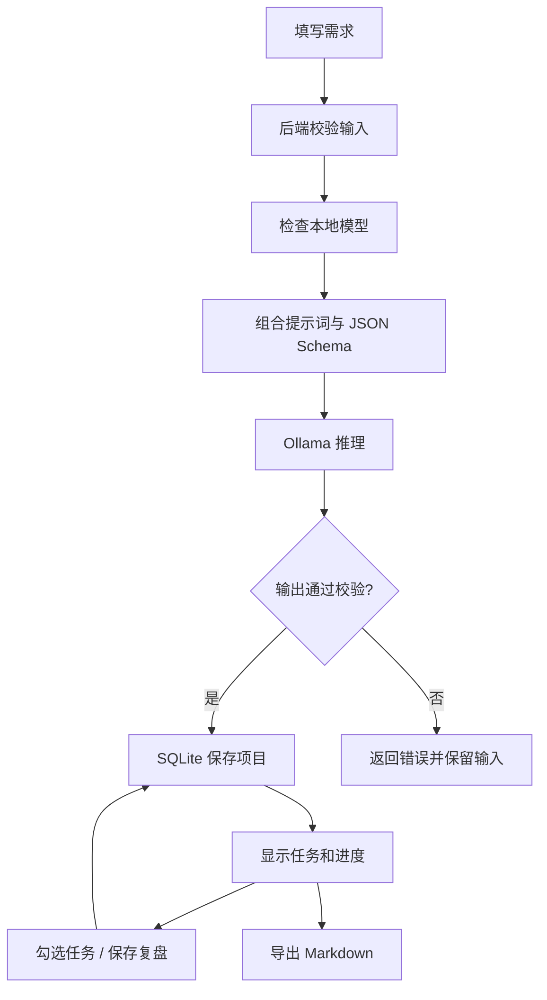

# 从输入到结果：读懂这条流程

本版本自动化的是「整理想法」，不会自动开发或执行项目。界面、后端和模型在同一台电脑上运行；浏览器负责交互，Node 负责验证、调用和保存，Ollama 负责本地推理。



## 文件边界

| 层         | 文件                  | 做什么                                                |
| ---------- | --------------------- | ----------------------------------------------------- |
| 用户输入   | `src/NewProject.tsx`  | 收集想法与限制，展示连接状态和提示词                  |
| 浏览器状态 | `src/App.tsx`         | 管理请求、当前项目、未保存复盘、取消与导航            |
| 输出显示   | `src/ProjectView.tsx` | 用 React 文本节点显示模型结果，不渲染模型 HTML        |
| 通用约定   | `shared/domain.ts`    | 类型、校验、输出 Schema、提示词版本和示例             |
| 请求边界   | `server/app.ts`       | 同源校验、32 KB 请求限制、路由、静态页面              |
| 模型边界   | `server/ollama.ts`    | 仅本机连接，模型白名单，180 秒推理超时，1 MB 响应上限 |
| 存储边界   | `server/store.ts`     | 参数化 SQL、SQLite WAL、版本冲突检查                  |
| 交付边界   | `server/export.ts`    | 将结果转换为 Markdown，转义用户和模型内容             |

JSON Schema 让模型知道要返回什么，但它不是信任依据。后端会再次检查字段、数量和长度：任何一步失败都不会创建半成品项目。模型只提供内容，不拥有执行权限。

## 本地接口

所有写请求必须为 `application/json`；来自其他网站的请求和非法 Host 会被拒绝。这里没有公网账户体系。

| 方法与路径                     | 输入                                                     | 输出 / 行为                                |
| ------------------------------ | -------------------------------------------------------- | ------------------------------------------ |
| `GET /api/health`              | 无                                                       | 版本和本地模式                             |
| `GET /api/models`              | 无                                                       | Ollama 是否连通、可选已安装模型、提示      |
| `GET /api/projects`            | 无                                                       | 按最近修改排序的项目摘要                   |
| `POST /api/projects`           | `Brief`                                                  | 生成、验证、保存后返回完整项目             |
| `POST /api/examples`           | `{}`                                                     | 保存带明确来源标记的人工教学示例           |
| `GET /api/projects/:id`        | 无                                                       | 项目、原始需求、提示词快照、任务状态、复盘 |
| `PATCH /api/projects/:id`      | `{ revision, taskIndex, done }` 或 `{ revision, notes }` | 返回新版本，旧版本返回 409                 |
| `GET /api/projects/:id/export` | 无                                                       | Markdown 下载                              |
| `DELETE /api/projects/:id`     | `{ revision }`                                           | 删除指定项目，旧版本不会删除新内容         |

输入例子：

```json
{
  "idea": "我想做一个本地学习笔记整理器，把知识变成复习卡片。",
  "constraints": "只给自己用，优先本地运行",
  "minutesPerDay": 60,
  "focus": "coding",
  "model": "qwen3:1.7b"
}
```

`focus` 可选 `coding`、`product`、`automation`。`model` 只支持显式的 `qwen3:1.7b`、`qwen3:4b`、`qwen3:8b`。

## 为什么这样取舍

- **React + TypeScript + Vite**：前端组件、状态、类型容易逐步学习，将来可以迁入 Tauri WebView。
- **Node 24 内置 HTTP/SQLite**：同一种语言贯穿全栈，不额外启动数据库或编译原生插件。项目限制在已验证的 24.x，并锁定依赖版本。
- **完整 JSON 返回后一次展示**：先保证结构正确和可保存，不把半截 JSON 当作计划。流式进度和逐字段展示另行设计。
- **一个进程同时只生成一个项目**：单人本地机器的模型资源有限；第二个请求返回 409，不偷偷排队。
- **保存提示词快照**：之后修改模板也能查看当时使用的内容。示例中的提示词仅供学习，没有实际发送给模型。
- **不接云模型**：本地服务就能完成当前目标。后续若接入，需单独定义授权、密钥保管和数据范围。

## 验证范围

自动测试包含真正的浏览器、HTTP 服务与 SQLite 文件读写，Ollama 部分使用测试专用协议模拟服务。它能发现接口、页面、存储和异常处理问题，**不能证明模型的内容质量、硬件兼容性或断网推理表现**。

后端测试中的模型响应不是真实推理；只有本机 Ollama 实际生成的结果才可用来验收模型质量。开发环境没有 Ollama 和模型权重，因此真机验收保留为未完成状态。
